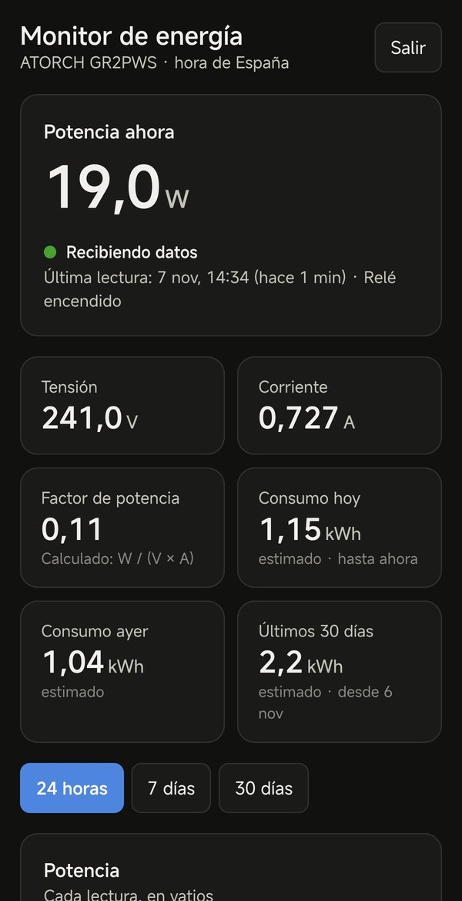
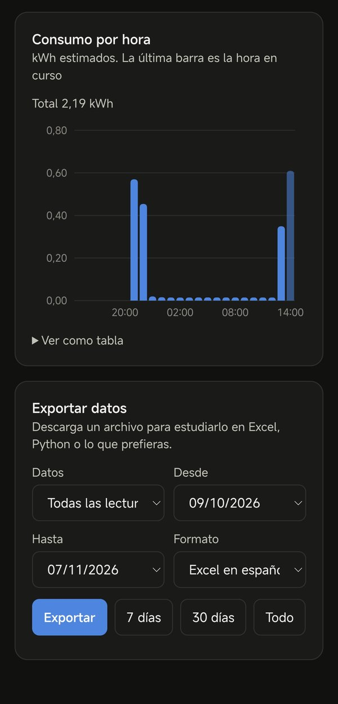

# ATORCH Tuya Monitor

[English](README.md) · **Español**

Guarda en una base de datos las lecturas de un **medidor de energía Wi-Fi ATORCH** (por ejemplo el de carril DIN GR2PWS) cada pocos minutos, **sin tener en casa ningún ordenador, Raspberry Pi ni Home Assistant encendido**, y consúltalas en un dashboard privado con gráficas y exportación a CSV.

Vale para medidores emparejados tanto en la app **Smart Life** como en la app **Tuya Smart**: las dos usan la misma nube de Tuya, así que la configuración es idéntica.

Todo funciona con planes gratuitos:

| Pieza | Servicio | Qué hace |
|---|---|---|
| Recolector | Cloudflare Workers (gratis) | Un cron lee el medidor desde la API cloud de Tuya cada 2 minutos |
| Base de datos | Supabase (gratis) | Guarda cada lectura, más vistas de consumo por hora y por día |
| Dashboard | El mismo Worker de Cloudflare | Página con contraseña: valores en directo, gráficas y exportación |

```text
Medidor ──Wi-Fi──► nube de Tuya ◄──API── Worker de Cloudflare (cron cada minuto)
                                              │   └─ token cacheado en Workers KV
                                              ▼
                                         Supabase (Postgres)
                                              ▲
                  Tú ──navegador──► Dashboard (mismo Worker, contraseña + cookie de sesión)
```

<p>
  
  
</p>

*Dashboard real en un móvil, en modo oscuro.*

> Proyecto no oficial: no tiene relación con ATORCH ni con Tuya. Úsalo bajo tu responsabilidad y lee los [límites de Tuya](#1-antes-de-empezar-límites-de-tuya) antes de empezar.

## Índice

1. [Antes de empezar: límites de Tuya](#1-antes-de-empezar-límites-de-tuya)
2. [Qué necesitas](#2-qué-necesitas)
3. [Emparejar el medidor en la app](#3-emparejar-el-medidor-en-la-app)
4. [Crear el proyecto cloud de Tuya](#4-crear-el-proyecto-cloud-de-tuya)
5. [Vincular tu cuenta de Smart Life / Tuya Smart](#5-vincular-tu-cuenta-de-smart-life--tuya-smart)
6. [Copiar el Device ID](#6-copiar-el-device-id)
7. [Crear la base de datos en Supabase](#7-crear-la-base-de-datos-en-supabase)
8. [Desplegar el Worker de Cloudflare](#8-desplegar-el-worker-de-cloudflare)
9. [Comprobar que llegan lecturas](#9-comprobar-que-llegan-lecturas)
10. [Comprobar el mapeo con /debug](#10-comprobar-el-mapeo-con-debug)
11. [Usar el dashboard y exportar datos](#11-usar-el-dashboard-y-exportar-datos)
12. [Cómo funciona](#12-cómo-funciona)
13. [Seguridad](#13-seguridad)
14. [Retención de datos](#14-retención-de-datos)
15. [Límites de los planes gratuitos](#15-límites-de-los-planes-gratuitos)
16. [Solución de problemas](#16-solución-de-problemas)
17. [Desarrollo](#17-desarrollo)
18. [Cómo se hizo este proyecto](#18-cómo-se-hizo-este-proyecto)

## 1. Antes de empezar: límites de Tuya

**Cuota de llamadas.** La [página de IoT Core](https://www.tuya.com/vas/commodity/IOT_CORE_V2) de Tuya habla de 26.000 llamadas al mes en la prueba, sin dejar claro a qué plan corresponde. Comprueba la tuya en tu proyecto, en *Cloud → My Services*. Estimación para un mes de 30 días:

| Intervalo | Lecturas al mes | Tokens al mes | Total de llamadas | ¿Cabe en 26.000? |
|---|---|---|---|---|
| 1 min | 43.200 | ~360 | ~43.560 | **No**: se agota hacia el día 18 |
| 2 min | 21.600 | ~360 | ~21.960 | Sí, con un margen de ~4.000 |
| 5 min | 8.640 | ~360 | ~9.000 | Sí, con mucho margen |

Por eso `READ_INTERVAL_MINUTES` viene a **2**. Cada llamada a `/debug` gasta 2 llamadas más, y los fallos gastan más por los reintentos.

**Caducidad de la prueba.** La prueba gratuita de IoT Core caduca (la nuestra, un mes después de crear el proyecto). Cuando caduca, las lecturas se paran y los fallos aparecen en la tabla `energy_errors` y como un aviso rojo en el dashboard. Se puede ampliar gratis desde *Cloud → My Services*: hay un formulario de solicitud de ampliación que Tuya revisa a mano. Nosotros pedimos 6 meses, el máximo que ofrecía. **Ponte un recordatorio** una semana antes de la fecha de caducidad que aparece ahí.

## 2. Qué necesitas

- Un **medidor Wi-Fi ATORCH** compatible con Smart Life / Tuya Smart. Este repo está ajustado para el **GR2PWS**; otros modelos funcionan tras ajustar [el mapeo](#10-comprobar-el-mapeo-con-debug).
- La app **Smart Life** o **Tuya Smart** en el móvil, con el medidor emparejado.
- Cuentas gratuitas en:
  - [Tuya IoT Platform](https://platform.tuya.com/) (una cuenta de *desarrollador*, distinta de la de la app)
  - [Cloudflare](https://dash.cloudflare.com/sign-up)
  - [Supabase](https://supabase.com/dashboard)
- En tu ordenador, solo para desplegar la primera vez: [Node.js 20 o posterior](https://nodejs.org/) y [Git](https://git-scm.com/). Después puedes apagarlo.

Coste total: 0 €.

## 3. Emparejar el medidor en la app

1. Instala el medidor siguiendo su manual. **Los modelos de carril DIN debe instalarlos un electricista cualificado.**
2. En Smart Life o Tuya Smart, pulsa **+** y añade el medidor. Necesita una red Wi-Fi de **2,4 GHz**.
3. Comprueba que la app muestra la potencia, la tensión y la corriente en directo.
4. Apunta el **país o región** de tu cuenta de la app (*Yo → Ajustes → Cuenta y seguridad → Región*). De ella depende el data center de Tuya que necesitas en el paso siguiente.

## 4. Crear el proyecto cloud de Tuya

1. Regístrate en [platform.tuya.com](https://platform.tuya.com/) y entra.
2. Ve a **Cloud → Development → Create Cloud Project** y rellena:
   - **Project name**: el que quieras, por ejemplo `energy-monitor`.
   - **Development Method**: Smart Home.
   - **Data Center**: el que corresponda a la región de tu cuenta de la app (tabla de abajo). Si dudas, añade varios.
3. En la pantalla siguiente, acepta los servicios de API que te propone. Necesitas al menos **IoT Core** y **Authorization Token Management**.
4. Abre el proyecto. En **Overview**, copia el **Access ID/Client ID** y el **Access Secret/Client Secret**. No compartas el secret.

| Región de la cuenta de la app | Data center de Tuya | `TUYA_BASE_URL` |
|---|---|---|
| La mayor parte de Europa, incluida España | Central Europe | `https://openapi.tuyaeu.com` |
| Algunas cuentas europeas | Western Europe | `https://openapi-weaz.tuyaeu.com` |
| América | Western America | `https://openapi.tuyaus.com` |
| América | Eastern America | `https://openapi-ueaz.tuyaus.com` |
| China | China | `https://openapi.tuyacn.com` |
| India | India | `https://openapi.tuyain.com` |

## 5. Vincular tu cuenta de Smart Life / Tuya Smart

1. En el proyecto cloud, ve a **Devices → Link App Account → Add App Account**. Aparece un código QR. Deja las opciones por defecto.
2. En la app, ve a la pestaña **Yo** y pulsa el **icono de escanear** de arriba a la derecha. Escanea el QR y confirma.
3. La cuenta aparece en la lista, y el medidor en **Devices → All Devices**.

Si la cuenta se vincula pero no aparece el medidor, tu cuenta de la app está en otro data center: añádelo al proyecto (*Overview → Data Center*) y usa la `TUYA_BASE_URL` correspondiente.

## 6. Copiar el Device ID

En **Devices → All Devices**, copia el **Device ID** del medidor.

## 7. Crear la base de datos en Supabase

1. En [Supabase](https://supabase.com/dashboard), pulsa **New project**. Elige un nombre, una contraseña fuerte para la base de datos (aquí no la vas a necesitar) y la región más cercana. Espera a que esté lista.
2. **Zona horaria.** Las horas y los días se agrupan en `Europe/Madrid`. Si vives en otra zona, abre [la migración](supabase/migrations/20261106000000_energy_monitor.sql) y sustituye todos los `Europe/Madrid` por tu [zona IANA](https://en.wikipedia.org/wiki/List_of_tz_database_time_zones), por ejemplo `America/Mexico_City`. Usa el mismo valor en `TIMEZONE` en el paso 8.
3. Abre **SQL Editor → New query**, pega el archivo de migración entero y pulsa **Run**. Debe terminar con *Success. No rows returned*.
4. Copia la **Project URL**: *Project Settings → Data API* (tiene la forma `https://abcdefgh.supabase.co`).
5. Copia una **clave secreta**: *Project Settings → API Keys*. Usa una **secret key** (`sb_secret_...`) o, en proyectos antiguos, la clave **`service_role`**. Las dos funcionan. **Nunca** la pongas en una página web ni la compartas: se salta toda la seguridad de la base de datos.

Qué crea la migración:

| Objeto | Para qué sirve |
|---|---|
| `energy_readings` | Una fila por lectura, con la respuesta cruda de Tuya en `raw` |
| `energy_errors` | Fallos del Worker |
| `energy_daily_archive` | Resumen diario de las lecturas ya borradas |
| `energy_intervals` | Energía entre cada par de lecturas (base de las otras vistas) |
| `energy_hourly`, `energy_daily` | Consumo por hora y por día en tu zona horaria |
| `energy_purge_old_data()` | Archiva y borra los datos antiguos |

Todas las tablas tienen RLS activado y **ninguna política pública**: solo la clave secreta puede leerlas o escribirlas.

## 8. Desplegar el Worker de Cloudflare

Abre una terminal y ejecuta cada comando en orden.

**8.1 Descargar el código y las herramientas**

```bash
git clone https://github.com/franfolgar/atorch-tuya-monitor.git
```

```bash
cd atorch-tuya-monitor
```

```bash
npm install
```

**8.2 Entrar en Cloudflare** (se abre el navegador para autorizar a Wrangler)

```bash
npx wrangler login
```

**8.3 Crear el espacio KV** donde se guarda el token de Tuya

```bash
npx wrangler kv namespace create TOKEN_CACHE
```

Devuelve un `id`. Guárdalo para el paso siguiente.

**8.4 Crear tu `wrangler.toml`**

```bash
cp wrangler.example.toml wrangler.toml
```

En PowerShell de Windows usa `Copy-Item wrangler.example.toml wrangler.toml`. Después edita `wrangler.toml`:

- `id` dentro de `[[kv_namespaces]]`: el id del paso 8.3.
- `TUYA_BASE_URL`: tu data center del paso 4.
- `TIMEZONE`: la misma zona que pusiste en la migración.
- `name` (opcional): el nombre del Worker, que forma parte de su URL.
- `READ_INTERVAL_MINUTES`: déjalo en `2` salvo que tu cuota sea mayor.

`wrangler.toml` está en `.gitignore`, así que tus ids nunca se suben al repo.

**8.5 Crear la contraseña del dashboard.** Debe tener **al menos 12 caracteres**; si no, el dashboard no arranca. Importa más que no se pueda adivinar que su largo: el código es público, así que cualquiera puede probar contraseñas contra tu URL, y los nombres, fechas o palabras comunes se prueban primero. Usa una aleatoria o 3–4 palabras sin relación (`tortuga-azul-mesa-lunes`). Esto genera una aleatoria; guárdala en tu gestor de contraseñas:

```bash
node -e "console.log(require('crypto').randomBytes(24).toString('base64url'))"
```

**8.6 Guardar los secrets.** Cada comando te pide el valor: pégalo y pulsa Intro. Se guardan cifrados en Cloudflare y no aparecen nunca ni en el código ni en el panel.

```bash
npx wrangler secret put TUYA_CLIENT_ID
```

```bash
npx wrangler secret put TUYA_CLIENT_SECRET
```

```bash
npx wrangler secret put TUYA_DEVICE_ID
```

```bash
npx wrangler secret put SUPABASE_URL
```

```bash
npx wrangler secret put SUPABASE_SERVICE_KEY
```

```bash
npx wrangler secret put DASHBOARD_PASSWORD
```

El primer `secret put` puede preguntar si quieres crear el Worker: responde **sí**.

**8.7 Desplegar**

```bash
npx wrangler deploy
```

Si es tu primer Worker, Wrangler te pide **registrar un subdominio `workers.dev`** (por ejemplo `tunombre`). Acéptalo, o créalo en el panel de Cloudflare en *Workers & Pages → tu subdominio*, y vuelve a desplegar. Al final te da la URL:

```text
https://atorch-tuya-monitor.tunombre.workers.dev
```

## 9. Comprobar que llegan lecturas

La primera ejecución del cron puede tardar **varios minutos** tras el primer despliegue (a nosotros, unos 8). Después llega una lectura cada 2 minutos.

- **En directo**: `npx wrangler tail` muestra cada ejecución.
- **En Supabase** (SQL Editor):

```sql
select ts, power_w, voltage_v, current_a, energy_kwh, relay_on
from energy_readings order by ts desc limit 10;

select * from energy_errors order by ts desc limit 10;

select * from energy_hourly order by hour_start desc limit 24;
select * from energy_daily order by day desc limit 30;
```

## 10. Comprobar el mapeo con /debug

Los medidores Tuya publican sus valores como *data points* (DP), números enteros con una escala. [src/mapping.ts](src/mapping.ts) los traduce a columnas. Estos están confirmados en el **GR2PWS**:

| DP | Columna | Escala | Ejemplo crudo → valor |
|---|---|---|---|
| `cur_power` | `power_w` | 0,01 | 2770 → 27,70 W |
| `cur_voltage` | `voltage_v` | 0,01 | 23851 → 238,51 V |
| `cur_current` | `current_a` | 0,001 | 742 → 0,742 A |
| `switch_1` | `relay_on` | — | `true` |
| `add_ele` | sin asignar (se guarda en `raw`) | 0,01 | se queda en 0 |

Notas sobre el GR2PWS:

- No publica factor de potencia ni frecuencia, así que esas columnas quedan a `null`. El dashboard calcula el factor de potencia como W / (V × A).
- **No tiene contador de energía acumulada.** `add_ele` («electricidad añadida») se quedó en 0 durante una carga de 1,8 kW que consumió alrededor de 1 kWh, así que `energy_kwh` se deja sin asignar a propósito. Los kWh de las vistas son una **estimación** que integra `power_w` entre lecturas. Los picos más cortos que el intervalo de lectura no se ven.

**Para comprobar o adaptar el mapeo** (otro modelo ATORCH, una actualización de firmware): entra en el dashboard y abre `/debug` en el mismo navegador:

```text
https://atorch-tuya-monitor.tunombre.workers.dev/debug
```

Devuelve un JSON con:

- `dp_table`: una fila por DP con el valor crudo, la unidad, la escala de Tuya, el valor ya escalado y la columna a la que va.
- `mapped_preview`: la fila que se guardaría con el mapeo actual.
- `status` y `specification`: las respuestas crudas de Tuya.

La `spec_scale` de Tuya es el número de decimales: `spec_scale: 2` equivale a `scale: 0.01` en `mapping.ts`. **Compara siempre con la pantalla del medidor**: nuestro primer intento salió 100 veces mayor (277 W en lugar de 27,7 W), y la pantalla (27,60 W) confirmó la escala buena. Si un DP agrupa varios valores (por ejemplo `phase_a` en base64), usa `transform` para decodificarlo. Corrige `DP_MAPPING`, vuelve a ejecutar `npx wrangler deploy` y, si hace falta, corrige las filas ya guardadas a partir de su columna `raw`.

## 11. Usar el dashboard y exportar datos

Abre la URL de tu Worker y entra con `DASHBOARD_PASSWORD`. La sesión dura 30 días. Si cambias la contraseña, se cierra en todos los dispositivos. En el móvil, puedes añadirla a la pantalla de inicio desde el menú del navegador.

- **Ahora**: potencia, tensión, corriente, factor de potencia calculado, estado del relé y cuándo llegó la última lectura.
- **Consumo**: hoy, ayer y últimos 30 días (kWh estimados).
- **Gráficas**: potencia de cada lectura y consumo por hora o por día, para 24 horas, 7 días o 30 días, con tooltip y opción *Ver como tabla*. Se actualiza cada minuto.
- **Avisos**: indica si dejan de llegar lecturas, y muestra un aviso rojo si hubo errores en las últimas 24 horas (por ejemplo, la prueba de Tuya caducada).
- **Exportar**: elige todas las lecturas, el consumo por hora o por día, el periodo y el formato:
  - *Excel en español*: separador `;` y coma decimal (se abre directamente en Excel en español).
  - *CSV estándar*: separador `,` y punto decimal (para Python, R, etc.).

  El archivo de lecturas incluye `add_ele_crudo` (el `add_ele` sin escalar) para poder estudiarlo. Los rangos grandes se descargan en páginas de 1.000 filas, así que no hay límite de tamaño. La clave secreta se queda siempre en el Worker.

## 12. Cómo funciona

- **Cron**: Cloudflare ejecuta el Worker cada minuto, y solo lee cuando el minuto es múltiplo de `READ_INTERVAL_MINUTES`.
- **API de Tuya**: las peticiones se firman con HMAC-SHA256 usando Web Crypto, sin SDK. El token de acceso (válido unas 2 h) se guarda en KV y se renueva 5 minutos antes de caducar. Si Tuya rechaza el token (códigos 1010–1012), se renueva y se reintenta una vez.
- **Estado del medidor**: `/v1.0/iot-03/devices/{id}/status`, con `/v1.0/devices/{id}/status` como alternativa.
- **El cron nunca se rompe**: cualquier fallo se captura, se registra en el log y, con `LOG_ERRORS_TO_DB = "true"`, se guarda en `energy_errors`.
- **Guardado**: una fila por lectura a través de la API REST de Supabase con la clave secreta, incluida la respuesta cruda completa.
- **Energía**: `energy_intervals` usa la diferencia de `energy_kwh` entre lecturas cuando hay un contador asignado. Si no (como en el GR2PWS), la estima con la potencia media de cada par de lecturas × el tiempo. Los huecos de más de 15 minutos no se estiman, para no inventar consumo durante un corte. Las columnas `kwh_counter` y `kwh_estimated` muestran cada método por separado.
- **Valores congelados**: si el medidor pierde el Wi-Fi, Tuya puede seguir devolviendo los últimos valores conocidos. Muchas lecturas idénticas seguidas pueden indicar que está desconectado.
- **Dashboard**: HTML y SVG servidos por el mismo Worker, sin frameworks ni scripts externos. Las respuestas de Supabase se unen como texto sin parsearlas, para no pasar del límite de CPU del plan gratuito.

## 13. Seguridad

El repositorio **no contiene ninguna clave**. Todo lo sensible vive en los secrets de Cloudflare o en tus archivos locales `wrangler.toml` y `.dev.vars`, que están en `.gitignore`.

| Medida | Detalle |
|---|---|
| Secrets | Guardados cifrados con `wrangler secret`. La clave secreta de Supabase nunca llega al navegador. |
| Contraseña fuerte | `DASHBOARD_PASSWORD` debe tener al menos 12 caracteres; si no, el dashboard se queda desactivado (las lecturas se siguen guardando). |
| Límite de intentos | 5 intentos por minuto por IP y 30 por minuto en total, con el binding Rate Limiting de Cloudflare. Al superarlos, el login responde *429 Demasiados intentos*, incluso con la contraseña buena. El límite es aproximado: en una prueba con 40 intentos rápidos pasaron los 13 primeros y después se colaron algunos. Frena mucho a quien intente adivinar, pero **lo que de verdad protege es una contraseña que no se pueda adivinar**. |
| Comparación en tiempo constante | Contraseñas y firmas se comparan por su hash SHA-256, sin salir antes de tiempo. |
| Sesión | Cookie firmada (HMAC-SHA256 con la contraseña) válida 30 días, `HttpOnly`, `Secure`, `SameSite=Strict`. Cambiar la contraseña invalida todas las sesiones. |
| CSRF | El login y el cierre de sesión rechazan peticiones de otros orígenes. |
| `/debug` | Solo con sesión iniciada. Ninguna clave va en la URL. |
| Cabeceras | Content-Security-Policy estricta con nonce por petición, `X-Frame-Options: DENY`, `nosniff`, `no-referrer`, HSTS, `noindex`. |
| Exportación | Solo tres vistas permitidas; fechas y cursores se validan antes de consultar Supabase. |
| Base de datos | RLS activado sin políticas públicas: la clave anon/publishable no puede leer nada. |
| Errores | El detalle de los errores de Supabase va al log, no al navegador. |

Lo que te toca a ti: guardar la contraseña en un gestor de contraseñas, no publicar la URL de tu Worker si no hace falta y cambiar los secrets si sospechas una filtración (`npx wrangler secret put ...` y volver a desplegar). Si encuentras una vulnerabilidad, lee [SECURITY.md](SECURITY.md).

## 14. Retención de datos

`energy_purge_old_data()` guarda en `energy_daily_archive` un resumen diario de lo anterior a 12 meses y borra esas lecturas y errores. `energy_daily` sigue mostrando los días archivados; `energy_hourly` no.

```sql
select * from energy_purge_old_data();              -- archiva y borra (12 meses)
select * from energy_purge_old_data(12, false);     -- borra sin archivar
```

**No se ejecuta sola.** Para programarla cada mes, activa `pg_cron` en Supabase (*Database → Extensions*) y ejecuta:

```sql
select cron.schedule('energy-purge', '0 4 1 * *', 'select public.energy_purge_old_data()');
```

A 2 minutos son unas 263.000 filas al año. Con `raw` e índices calculamos unos 130–260 MB al año (sin medir), frente a los 500 MB del plan gratuito de Supabase.

## 15. Límites de los planes gratuitos

| Servicio | Límite | Uso de este proyecto |
|---|---|---|
| Cloudflare Workers | 100.000 peticiones/día, 10 ms de CPU por petición, 5 crons por cuenta | 1.440 ejecuciones del cron al día más tus visitas al dashboard; 1 cron |
| Workers KV | 1.000 escrituras/día | ~12 escrituras/día (token) |
| Supabase | 500 MB de base de datos; los proyectos gratuitos inactivos se pausan | Ver retención. El Worker escribe cada 2 minutos. |
| Prueba de Tuya IoT Core | Ver la [sección 1](#1-antes-de-empezar-límites-de-tuya) | ~22.000 llamadas al mes a 2 minutos |

Los límites cambian: consulta la página de precios actual de cada servicio.

## 16. Solución de problemas

| Síntoma | Causa probable y solución |
|---|---|
| El despliegue pide registrar un subdominio `workers.dev` | Es el primer Worker de la cuenta: ejecuta `npx wrangler deploy` en la terminal y acepta, o créalo en *Workers & Pages*. |
| No hay filas tras unos minutos | El primer cron puede tardar unos 10 minutos. Después revisa `npx wrangler tail` y `energy_errors`. |
| Tuya `sign invalid` (1004) | Client ID o Secret incorrectos, o un espacio de más al pegarlos. Repite el `wrangler secret put`. |
| Tuya `permission deny` (1106) o el dispositivo no aparece | La cuenta de la app no está vinculada, o `TUYA_BASE_URL` es de otro data center que el de la cuenta. |
| Error de Tuya que habla de una suscripción o prueba caducada | La prueba de IoT Core ha caducado: amplíala en *Cloud → My Services* (sección 1). |
| Supabase HTTP 401 | `SUPABASE_SERVICE_KEY` incorrecta (puede que pegaras la publishable/anon). |
| Supabase HTTP 404 `relation ... does not exist` | No se ejecutó la migración, o se ejecutó en otro proyecto. |
| Valores 100 veces mayores o menores | `scale` incorrecta en `mapping.ts`: compara `/debug` con la pantalla del medidor. |
| El dashboard responde 503 | Falta `DASHBOARD_PASSWORD` o tiene menos de 12 caracteres. |
| El login responde *Demasiados intentos* (429) | Has llegado al límite de intentos: espera un minuto. |
| `/debug` responde 401 | Entra primero en el dashboard, en el mismo navegador. |
| Horas o días desplazados | `TIMEZONE` no coincide con la zona de las vistas SQL. |

## 17. Desarrollo

```bash
npm test
```

```bash
npm run typecheck
```

Para probar en local, copia `.dev.vars.example` como `.dev.vars` y rellénalo (está en `.gitignore`). Después ejecuta `npm run dev` y lanza el cron abriendo `http://localhost:8787/__scheduled?cron=*+*+*+*+*`. El dashboard está en `http://localhost:8787/`.

| Secret | Valor |
|---|---|
| `TUYA_CLIENT_ID` | Access ID de Tuya |
| `TUYA_CLIENT_SECRET` | Access Secret de Tuya |
| `TUYA_DEVICE_ID` | Device ID del medidor |
| `SUPABASE_URL` | URL del proyecto de Supabase |
| `SUPABASE_SERVICE_KEY` | Clave `sb_secret_...` o `service_role` |
| `DASHBOARD_PASSWORD` | Contraseña del dashboard, 12 caracteres o más |

Estructura:

```text
src/index.ts         cron, /debug y rutas
src/tuya.ts          firma de Tuya, caché del token, estado y especificación
src/mapping.ts       mapeo DP → columna (edítalo para otros medidores)
src/supabase.ts      insertar y leer a través de PostgREST
src/dashboard.ts     login, límite de intentos, sesión, API de resumen y exportación
src/dashboard.html   dashboard (HTML, CSS, gráficas SVG, exportación CSV)
src/login.html       página de login
supabase/migrations  tablas, vistas y función de retención
test/                tests con vitest (firma de Tuya, mapeo, seguridad, exportación)
```

GitHub Actions comprueba los tipos, pasa los tests y hace un build de prueba en cada push.

## 18. Cómo se hizo este proyecto

Se hizo en una conversación con **Claude Code**, el agente de programación de Anthropic: desde la especificación (Worker con cron, token cacheado, firma escrita a mano, vistas en Supabase, retención) hasta el despliegue, la comprobación del mapeo con la pantalla del medidor y el dashboard.

Las gráficas siguen el **skill `dataviz`** que viene con Claude Code, un procedimiento para diseñar gráficas:

- **La forma sigue a la función del dato**: cifras grandes (tarjetas) para los valores actuales, una línea para la potencia en el tiempo y barras para el consumo por hora o por día.
- **Una serie, un color**: azul `#2a78d6` en modo claro y `#3987e5` en modo oscuro. El modo oscuro se elige aparte, no se invierte automáticamente. Verde, ámbar y rojo se reservan para estados, y siempre van con texto, nunca solo con color.
- **Marcas finas y rejilla discreta**: líneas de 2 px, barras con los extremos redondeados de 4 px apoyadas en la línea base, rejilla suave y pocas etiquetas en los ejes.
- **Interacción por defecto**: cruceta y tooltip en la línea y tooltip en cada barra, con la alternativa *Ver como tabla* para accesibilidad.
- **Sin librería de gráficas**: SVG hecho a mano y redimensionado con un `ResizeObserver`. Así la página pesa poco y la CSP puede bloquear cualquier script externo.

## Licencia

[MIT](LICENSE). Sin relación con ATORCH, Tuya, Cloudflare ni Supabase; los nombres pertenecen a sus dueños.
