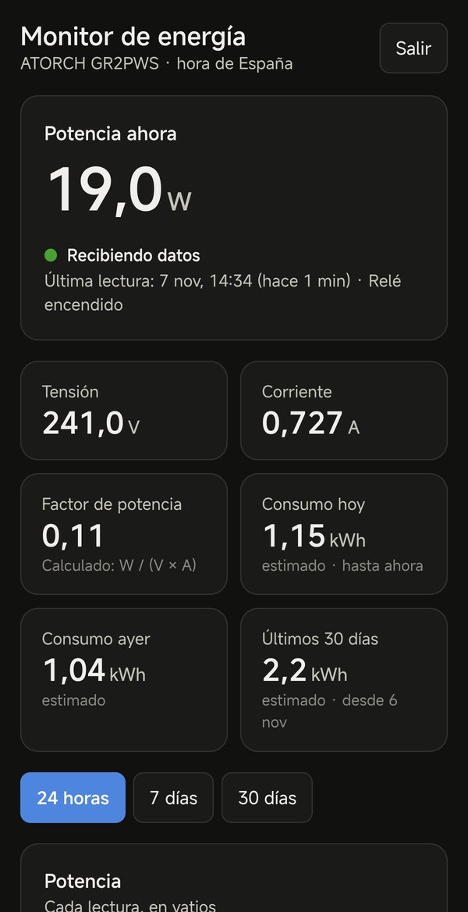
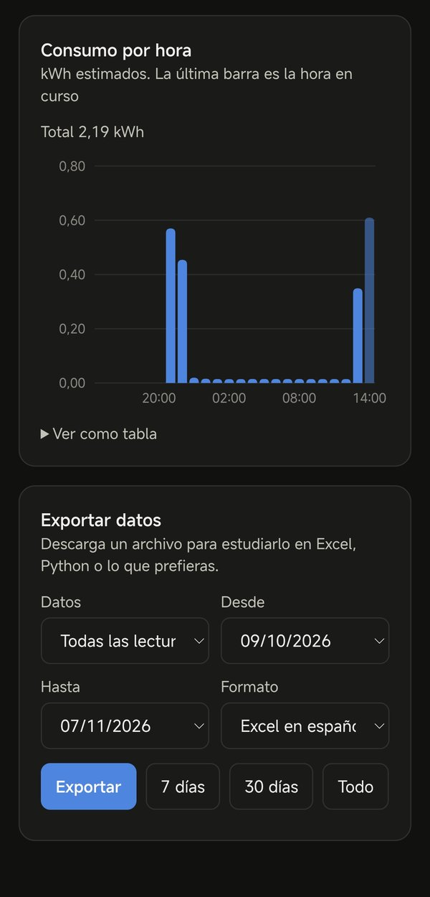

# ATORCH Tuya Monitor

**English** · [Español](README.es.md)

Log the readings of an **ATORCH Wi-Fi energy meter** (for example the GR2PWS DIN-rail meter) to a database every few minutes, **without any computer, Raspberry Pi or Home Assistant running at home**, and browse them in a private dashboard with charts and CSV export.

It works with meters paired in either the **Smart Life** app or the **Tuya Smart** app: both are the same Tuya cloud, so the setup is identical.

Everything runs on free plans:

| Piece | Service | What it does |
|---|---|---|
| Collector | Cloudflare Workers (free) | A cron job reads the meter from the Tuya cloud API every 2 minutes |
| Database | Supabase (free) | Stores every reading, plus hourly and daily consumption views |
| Dashboard | Same Cloudflare Worker | Password-protected page with live values, charts and export |

```text
Meter ──Wi-Fi──► Tuya cloud ◄──API── Cloudflare Worker (cron every minute)
                                          │   └─ token cached in Workers KV
                                          ▼
                                     Supabase (Postgres)
                                          ▲
                You ──browser──► Dashboard (same Worker, password + session cookie)
```

<p>
  
  
</p>

*Real dashboard on a phone, dark mode. The interface is in Spanish (see [Language](#language)).*

> Not affiliated with ATORCH or Tuya. Use at your own risk; read the [Tuya limits](#1-before-you-start-tuya-limits) before you start.

## Contents

1. [Before you start: Tuya limits](#1-before-you-start-tuya-limits)
2. [What you need](#2-what-you-need)
3. [Pair the meter in the app](#3-pair-the-meter-in-the-app)
4. [Create the Tuya cloud project](#4-create-the-tuya-cloud-project)
5. [Link your Smart Life / Tuya Smart account](#5-link-your-smart-life--tuya-smart-account)
6. [Copy the Device ID](#6-copy-the-device-id)
7. [Create the Supabase database](#7-create-the-supabase-database)
8. [Deploy the Cloudflare Worker](#8-deploy-the-cloudflare-worker)
9. [Check that readings arrive](#9-check-that-readings-arrive)
10. [Check the DP mapping with /debug](#10-check-the-dp-mapping-with-debug)
11. [Using the dashboard and exporting data](#11-using-the-dashboard-and-exporting-data)
12. [How it works](#12-how-it-works)
13. [Security](#13-security)
14. [Data retention](#14-data-retention)
15. [Free plan limits](#15-free-plan-limits)
16. [Troubleshooting](#16-troubleshooting)
17. [Development](#17-development)
18. [How this project was built](#18-how-this-project-was-built)

## 1. Before you start: Tuya limits

**API quota.** Tuya's [IoT Core page](https://www.tuya.com/vas/commodity/IOT_CORE_V2) mentions 26,000 API calls per month for the trial, without making clear which plan that applies to. Check your own quota in your project under *Cloud → My Services*. Estimate for a 30-day month:

| Interval | Readings / month | Token requests / month | Total calls | Fits in 26,000? |
|---|---|---|---|---|
| 1 min | 43,200 | ~360 | ~43,560 | **No**: runs out around day 18 |
| 2 min | 21,600 | ~360 | ~21,960 | Yes, ~4,000 spare |
| 5 min | 8,640 | ~360 | ~9,000 | Yes, plenty spare |

That is why `READ_INTERVAL_MINUTES` defaults to **2**. Each `/debug` call spends 2 extra calls, and failures spend more because of retries.

**Trial expiry.** The free IoT Core trial expires (ours was one month after creating the project). When it expires the readings stop and the failures appear in the `energy_errors` table and as a red banner in the dashboard. You can extend it for free from *Cloud → My Services*: there is an extension request form, and Tuya reviews it manually. We asked for 6 months, the maximum the form offered. **Put a reminder in your calendar** a week before the expiry date shown there.

## 2. What you need

- An **ATORCH Wi-Fi meter** that works with Smart Life / Tuya Smart. This repo is tuned for the **GR2PWS**; other models work after adjusting [the mapping](#10-check-the-dp-mapping-with-debug).
- The **Smart Life** or **Tuya Smart** app on your phone, with the meter paired.
- Free accounts on:
  - [Tuya IoT Platform](https://platform.tuya.com/) (a *developer* account, separate from the app account)
  - [Cloudflare](https://dash.cloudflare.com/sign-up)
  - [Supabase](https://supabase.com/dashboard)
- On your computer, only for the initial deploy: [Node.js 20 or later](https://nodejs.org/) and [Git](https://git-scm.com/). After deploying you can switch the computer off.

Total cost: €0/$0.

## 3. Pair the meter in the app

1. Install the meter following its manual. **The DIN-rail models must be installed by a qualified electrician.**
2. In Smart Life or Tuya Smart, tap **+** and add the meter. It needs a **2.4 GHz** Wi-Fi network.
3. Check that the app shows live power, voltage and current.
4. Note the **country/region** of your app account (*Me → Settings → Account and Security → Region*). It decides the Tuya data center you need in the next step.

## 4. Create the Tuya cloud project

1. Sign up at [platform.tuya.com](https://platform.tuya.com/) and log in.
2. Go to **Cloud → Development → Create Cloud Project** and fill in:
   - **Project name**: anything, for example `energy-monitor`.
   - **Development Method**: Smart Home.
   - **Data Center**: the one matching your app account region (table below). If in doubt, add several.
3. On the next screen, accept the suggested API services. You need at least **IoT Core** and **Authorization Token Management**.
4. Open the project. In **Overview**, copy the **Access ID/Client ID** and the **Access Secret/Client Secret**. Keep the secret private.

| App account region | Tuya data center | `TUYA_BASE_URL` |
|---|---|---|
| Most of Europe | Central Europe | `https://openapi.tuyaeu.com` |
| Some European accounts | Western Europe | `https://openapi-weaz.tuyaeu.com` |
| Americas | Western America | `https://openapi.tuyaus.com` |
| Americas | Eastern America | `https://openapi-ueaz.tuyaus.com` |
| China | China | `https://openapi.tuyacn.com` |
| India | India | `https://openapi.tuyain.com` |

## 5. Link your Smart Life / Tuya Smart account

1. In the cloud project, go to **Devices → Link App Account → Add App Account**. A QR code appears. Leave the default options.
2. In the app, go to the **Me** tab and tap the **scan icon** in the top right corner. Scan the QR and confirm.
3. The account appears in the list and the meter in **Devices → All Devices**.

If the account links but the meter list is empty, your app account is in another data center: add it to the project (*Overview → Data Center*) and use the matching `TUYA_BASE_URL`.

## 6. Copy the Device ID

In **Devices → All Devices**, copy the **Device ID** of the meter.

## 7. Create the Supabase database

1. In [Supabase](https://supabase.com/dashboard), click **New project**. Choose a name, a strong database password (you will not need it here) and the region closest to you. Wait until it is ready.
2. **Time zone.** Hours and days are grouped in `Europe/Madrid`. If you live elsewhere, open [the migration](supabase/migrations/20261106000000_energy_monitor.sql) and replace every `Europe/Madrid` with your [IANA time zone](https://en.wikipedia.org/wiki/List_of_tz_database_time_zones), for example `America/Mexico_City`. Use the same value in `TIMEZONE` in step 8.
3. Open **SQL Editor → New query**, paste the whole migration file and click **Run**. It should finish with *Success. No rows returned*.
4. Copy the **Project URL**: *Project Settings → Data API* (it looks like `https://abcdefgh.supabase.co`).
5. Copy a **secret key**: *Project Settings → API Keys*. Use a **secret key** (`sb_secret_...`) or, in older projects, the **`service_role`** key. Both work. **Never** use it in a web page or share it: it bypasses all database security.

What the migration creates:

| Object | Purpose |
|---|---|
| `energy_readings` | One row per reading, with Tuya's raw response in `raw` |
| `energy_errors` | Worker failures |
| `energy_daily_archive` | Daily summary of readings already purged |
| `energy_intervals` | Energy between each pair of readings (base of the other views) |
| `energy_hourly`, `energy_daily` | Consumption per hour and per day in your time zone |
| `energy_purge_old_data()` | Archives and deletes old data |

All tables have Row Level Security enabled and **no public policies**: only the secret key can read or write them.

## 8. Deploy the Cloudflare Worker

Open a terminal and run each command in order.

**8.1 Get the code and the tools**

```bash
git clone https://github.com/franfolgar/atorch-tuya-monitor.git
```

```bash
cd atorch-tuya-monitor
```

```bash
npm install
```

**8.2 Log in to Cloudflare** (a browser window opens to authorize Wrangler)

```bash
npx wrangler login
```

**8.3 Create the KV namespace** that caches the Tuya token

```bash
npx wrangler kv namespace create TOKEN_CACHE
```

It prints an `id`. Keep it for the next step.

**8.4 Create your `wrangler.toml`**

```bash
cp wrangler.example.toml wrangler.toml
```

On Windows PowerShell use `Copy-Item wrangler.example.toml wrangler.toml`. Then edit `wrangler.toml`:

- `id` under `[[kv_namespaces]]`: the id from 8.3.
- `TUYA_BASE_URL`: your data center from step 4.
- `TIMEZONE`: the same zone you used in the migration.
- `name` (optional): the Worker name, which becomes part of its URL.
- `READ_INTERVAL_MINUTES`: leave `2` unless your quota is larger.

`wrangler.toml` is in `.gitignore`, so your ids are never committed.

**8.5 Create a dashboard password.** It must be **at least 12 characters**; otherwise the dashboard refuses to start. Length matters less than being unguessable: the code is public, so anyone can try passwords against your URL, and names, dates or common words are tried first. Use a random one or 3–4 unrelated words (`turtle-blue-table-monday`). This generates a random one; save it in your password manager:

```bash
node -e "console.log(require('crypto').randomBytes(24).toString('base64url'))"
```

**8.6 Store the secrets.** Each command asks for the value; paste it and press Enter. Secrets are stored encrypted in Cloudflare and never appear in the code or in the dashboard.

```bash
npx wrangler secret put TUYA_CLIENT_ID
```

```bash
npx wrangler secret put TUYA_CLIENT_SECRET
```

```bash
npx wrangler secret put TUYA_DEVICE_ID
```

```bash
npx wrangler secret put SUPABASE_URL
```

```bash
npx wrangler secret put SUPABASE_SERVICE_KEY
```

```bash
npx wrangler secret put DASHBOARD_PASSWORD
```

The first `secret put` may ask whether to create the Worker: answer **yes**.

**8.7 Deploy**

```bash
npx wrangler deploy
```

If this is your first Worker, Wrangler asks you to **register a `workers.dev` subdomain** (for example `yourname`). Accept, or create it in the Cloudflare dashboard under *Workers & Pages → your subdomain*, and run the deploy again. At the end it prints the URL:

```text
https://atorch-tuya-monitor.yourname.workers.dev
```

## 9. Check that readings arrive

The first cron run can take **several minutes** after the first deploy (it took about 8 minutes for us). Then a reading arrives every 2 minutes.

- **Live log**: `npx wrangler tail` shows each run.
- **In Supabase** (SQL Editor):

```sql
select ts, power_w, voltage_v, current_a, energy_kwh, relay_on
from energy_readings order by ts desc limit 10;

select * from energy_errors order by ts desc limit 10;

select * from energy_hourly order by hour_start desc limit 24;
select * from energy_daily order by day desc limit 30;
```

## 10. Check the DP mapping with /debug

Tuya meters report values as *data points* (DPs) with integer values and a scale. [src/mapping.ts](src/mapping.ts) translates them into columns. These are confirmed on the **GR2PWS**:

| DP | Column | Scale | Example raw → value |
|---|---|---|---|
| `cur_power` | `power_w` | 0.01 | 2770 → 27.70 W |
| `cur_voltage` | `voltage_v` | 0.01 | 23851 → 238.51 V |
| `cur_current` | `current_a` | 0.001 | 742 → 0.742 A |
| `switch_1` | `relay_on` | — | `true` |
| `add_ele` | not mapped (kept in `raw`) | 0.01 | stays 0 |

Notes about the GR2PWS:

- It does not report power factor or frequency, so those columns stay `null`. The dashboard computes the power factor as W / (V × A).
- **There is no cumulative energy counter.** `add_ele` ("added electricity") stayed at 0 during a 1.8 kW load that consumed about 1 kWh, so `energy_kwh` is left unmapped on purpose. The kWh in the views are **estimated** by integrating `power_w` between readings. Spikes shorter than the reading interval are not captured.

**To check or adapt the mapping** (another ATORCH model, a firmware update): log in to the dashboard, then open `/debug` in the same browser:

```text
https://atorch-tuya-monitor.yourname.workers.dev/debug
```

It returns JSON with:

- `dp_table`: one row per DP with raw value, unit, Tuya's scale, scaled value and the column it maps to.
- `mapped_preview`: the row that would be stored with the current mapping.
- `status` and `specification`: Tuya's raw responses.

Tuya's `spec_scale` is the number of decimals: `spec_scale: 2` means `scale: 0.01` in `mapping.ts`. **Always compare with the meter's own display**: our first guess was off by 100× (277 W instead of 27.7 W), and the display (27.60 W) confirmed the right scale. If a DP packs several values (for example `phase_a` in base64), use `transform` to decode it. Edit `DP_MAPPING`, run `npx wrangler deploy` again, and fix any rows already stored from their `raw` column if needed.

## 11. Using the dashboard and exporting data

Open your Worker URL and log in with `DASHBOARD_PASSWORD`. The session lasts 30 days. Changing the password logs out every device. On a phone, add it to the home screen from the browser menu.

- **Now**: current power, voltage, current, calculated power factor, relay state and when the last reading arrived.
- **Consumption**: today, yesterday and last 30 days (estimated kWh).
- **Charts**: power for each reading and consumption per hour or per day, for 24 hours, 7 days or 30 days, with a tooltip and a *View as table* option. It refreshes every minute.
- **Alerts**: a warning if readings stop arriving and a red banner if there were errors in the last 24 hours (for example, an expired Tuya trial).
- **Export**: choose all readings, consumption per hour or per day, the date range and the format:
  - *Excel en español*: `;` separator and decimal comma (opens directly in Excel with Spanish/European settings).
  - *CSV estándar*: `,` separator and decimal point (for Python, R, LibreOffice in English, etc.).

  The readings file includes `add_ele_crudo` (raw `add_ele`) so you can study it. Large ranges are downloaded in pages of 1,000 rows, so there is no size limit. The secret key always stays in the Worker.

## 12. How it works

- **Cron**: Cloudflare runs the Worker every minute; it only reads when the minute is a multiple of `READ_INTERVAL_MINUTES`.
- **Tuya API**: requests are signed with HMAC-SHA256 using Web Crypto (no SDK). The access token (valid ~2 h) is cached in KV and renewed 5 minutes before it expires. If Tuya rejects the token (codes 1010–1012), it is renewed and the request is retried once.
- **Status endpoint**: `/v1.0/iot-03/devices/{id}/status`, with `/v1.0/devices/{id}/status` as a fallback.
- **Never breaks the cron**: any failure is caught, logged and, with `LOG_ERRORS_TO_DB = "true"`, stored in `energy_errors`.
- **Storage**: one row per reading via Supabase's REST API with the secret key, including the full raw response.
- **Energy**: `energy_intervals` uses the difference of `energy_kwh` between readings when a counter is mapped. Otherwise (as on the GR2PWS) it estimates with the average power of each pair of readings × time. Gaps longer than 15 minutes are not estimated, so an outage does not invent consumption. The `kwh_counter` and `kwh_estimated` columns show each method separately.
- **Stale values**: if the meter loses Wi-Fi, Tuya may keep returning the last known values. Identical readings for a long time can mean the meter is offline.
- **Dashboard**: plain HTML and SVG served by the same Worker, without frameworks or external scripts. Supabase responses are joined as text without parsing them, to stay within the free plan's CPU limit.

## 13. Security

The repository contains **no keys**. Everything sensitive lives in Cloudflare secrets or in your local, git-ignored `wrangler.toml` and `.dev.vars`.

| Measure | Detail |
|---|---|
| Secrets | Stored encrypted with `wrangler secret`. The Supabase secret key never reaches the browser. |
| Strong password | `DASHBOARD_PASSWORD` must have at least 12 characters, or the dashboard stays disabled (readings keep being stored). |
| Login rate limit | 5 attempts per minute per IP and 30 per minute globally, with Cloudflare's Rate Limiting binding. After that the login answers *429 Too many attempts*, even with the right password. The limiter is approximate: in a test with 40 fast attempts, the first 13 got through and some later ones still slipped past. It slows guessing down a lot, but **an unguessable password is still what really protects you**. |
| Constant-time comparison | Passwords and signatures are compared via their SHA-256 hashes, without early exit. |
| Session | Signed cookie (HMAC-SHA256 with the password) valid for 30 days, `HttpOnly`, `Secure`, `SameSite=Strict`. Changing the password invalidates all sessions. |
| CSRF | Login and logout reject requests from other origins. |
| `/debug` | Only with a logged-in session. No keys in URLs. |
| Headers | Strict Content-Security-Policy with a per-request nonce, `X-Frame-Options: DENY`, `nosniff`, `no-referrer`, HSTS, `noindex`. |
| Export | Only three whitelisted views; dates and cursors are validated before querying Supabase. |
| Database | RLS enabled with no public policies; the anon/publishable key cannot read anything. |
| Errors | Supabase error details are logged, not shown to the browser. |

Your responsibilities: keep the password in a password manager, do not share your Worker URL publicly if you do not need to, and rotate secrets if you suspect a leak (`npx wrangler secret put ...` and redeploy). If you find a vulnerability, please read [SECURITY.md](SECURITY.md).

## 14. Data retention

`energy_purge_old_data()` stores a daily summary of data older than 12 months in `energy_daily_archive` and deletes those readings and errors. `energy_daily` keeps showing the archived days; `energy_hourly` does not.

```sql
select * from energy_purge_old_data();              -- archive and delete (12 months)
select * from energy_purge_old_data(12, false);     -- delete without archiving
```

**It does not run automatically.** To run it every month, enable `pg_cron` in Supabase (*Database → Extensions*) and run:

```sql
select cron.schedule('energy-purge', '0 4 1 * *', 'select public.energy_purge_old_data()');
```

At 2 minutes there are about 263,000 rows per year. With `raw` and indexes we estimate 130–260 MB per year (not measured), against the 500 MB of Supabase's free plan.

## 15. Free plan limits

| Service | Limit | Usage of this project |
|---|---|---|
| Cloudflare Workers | 100,000 requests/day, 10 ms CPU per request, 5 cron triggers per account | 1,440 cron runs/day + your dashboard visits; 1 cron trigger |
| Workers KV | 1,000 writes/day | ~12 writes/day (token) |
| Supabase | 500 MB database; inactive free projects are paused | See retention. The Worker writes every 2 minutes. |
| Tuya IoT Core trial | See [section 1](#1-before-you-start-tuya-limits) | ~22,000 calls/month at 2 minutes |

Limits change; check each provider's current pricing page.

## 16. Troubleshooting

| Symptom | Likely cause and fix |
|---|---|
| Deploy says you must register a `workers.dev` subdomain | First Worker in the account: run `npx wrangler deploy` interactively and accept, or create it in *Workers & Pages*. |
| No rows after a few minutes | The first cron can take ~10 minutes. Then check `npx wrangler tail` and `energy_errors`. |
| Tuya `sign invalid` (1004) | Wrong Client ID/Secret, or a trailing space when pasting. Run `wrangler secret put` again. |
| Tuya `permission deny` (1106) or device not found | The app account is not linked, or `TUYA_BASE_URL` is a different data center than the account. |
| Tuya error mentioning an expired subscription or trial | The IoT Core trial expired: extend it in *Cloud → My Services* (section 1). |
| Supabase HTTP 401 | Wrong `SUPABASE_SERVICE_KEY` (you may have pasted the publishable/anon key). |
| Supabase HTTP 404 `relation ... does not exist` | The migration was not run, or it was run in another project. |
| Values 100× too big or small | Wrong `scale` in `mapping.ts`: compare `/debug` with the meter's display. |
| Dashboard answers 503 | `DASHBOARD_PASSWORD` is missing or shorter than 12 characters. |
| Login answers *Demasiados intentos* (429) | Rate limit reached: wait one minute. |
| `/debug` answers 401 | Log in to the dashboard first, in the same browser. |
| Hours or days shifted | `TIMEZONE` and the zone in the SQL views differ. |

## 17. Development

```bash
npm test
```

```bash
npm run typecheck
```

To run it locally, copy `.dev.vars.example` to `.dev.vars` and fill it in (it is git-ignored). Then run `npm run dev` and trigger the cron by opening `http://localhost:8787/__scheduled?cron=*+*+*+*+*`. The dashboard is at `http://localhost:8787/`.

| Secret | Value |
|---|---|
| `TUYA_CLIENT_ID` | Tuya Access ID |
| `TUYA_CLIENT_SECRET` | Tuya Access Secret |
| `TUYA_DEVICE_ID` | The meter's Device ID |
| `SUPABASE_URL` | Supabase project URL |
| `SUPABASE_SERVICE_KEY` | `sb_secret_...` or `service_role` key |
| `DASHBOARD_PASSWORD` | Dashboard password, 12+ characters |

Project layout:

```text
src/index.ts         cron, /debug and routing
src/tuya.ts          Tuya signing, token cache, status and specification
src/mapping.ts       DP → column mapping (edit for other meters)
src/supabase.ts      insert and select through PostgREST
src/dashboard.ts     login, rate limit, session, summary and export API
src/dashboard.html   dashboard (HTML, CSS, SVG charts, CSV export)
src/login.html       login page
supabase/migrations  tables, views, retention function
test/                vitest tests (Tuya signature, mapping, security, export)
```

GitHub Actions runs the type check, the tests and a dry-run build on each push.

### Language

The dashboard and the code comments are in Spanish; numbers and dates use the Spanish format. Translations are welcome.

## 18. How this project was built

It was built in a conversation with **Claude Code**, Anthropic's coding agent: from the specification (cron Worker, cached token, handwritten signature, Supabase views, retention) to deployment, checking the mapping against the meter's display, and the dashboard.

The charts follow Claude Code's built-in **`dataviz` skill**, a procedure for designing charts:

- **The form follows the job of the data**: big numbers (stat tiles) for current values, a line for power over time, bars for consumption per hour/day.
- **One series, one color**: blue `#2a78d6` in light mode and `#3987e5` in dark mode, with dark mode chosen separately, not automatically inverted. Green, amber and red are reserved for status, and are always shown with text, never color alone.
- **Thin marks and a recessive grid**: 2 px lines, bars with 4 px rounded ends anchored to the baseline, light gridlines, and only a few axis labels.
- **Interaction by default**: a crosshair and tooltip on the line and a tooltip on each bar, with a *View as table* alternative for accessibility.
- **No chart library**: hand-built SVG, resized with a `ResizeObserver`. That keeps the page small and lets the CSP block any external script.

## License

[MIT](LICENSE). Not affiliated with ATORCH, Tuya, Cloudflare or Supabase; the names belong to their owners.
